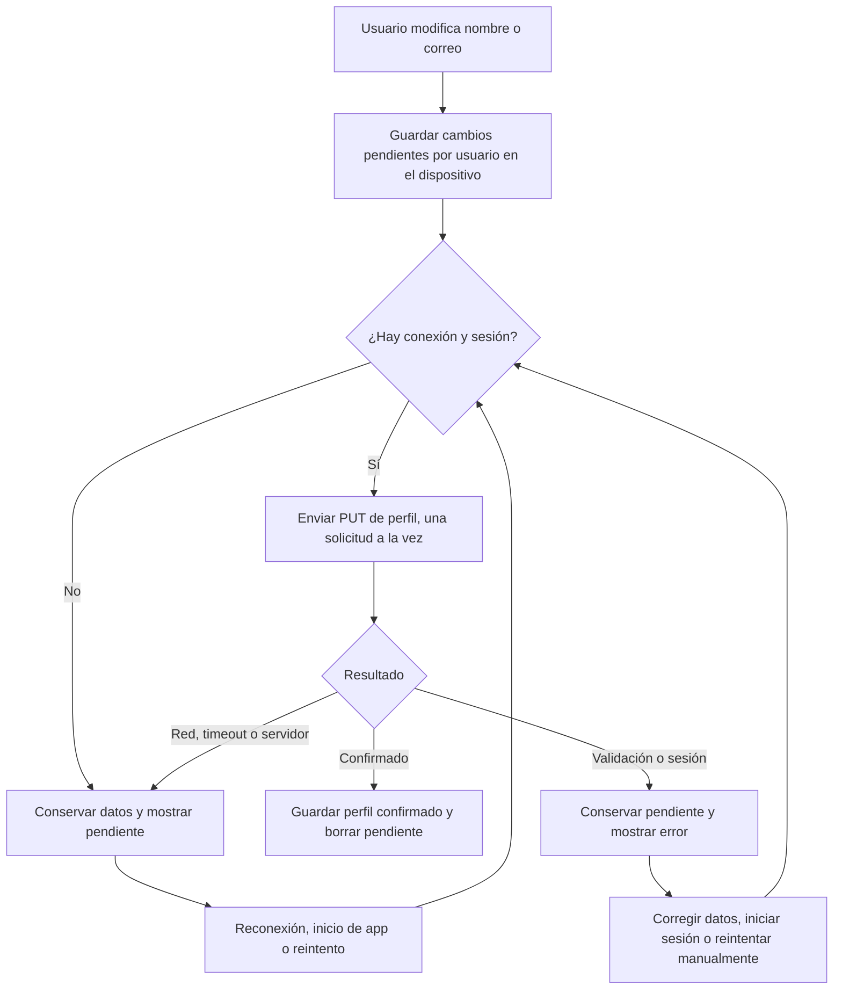
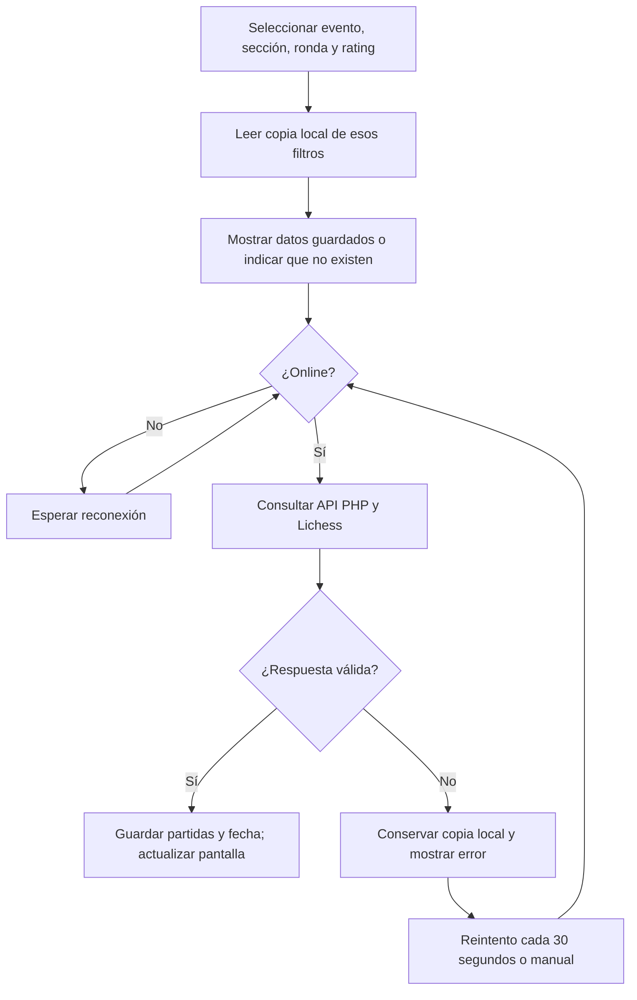

# Entrega: persistencia local y remota

## Implementación

| Requisito | Implementación |
|---|---|
| Persistencia local | Perfil y sesión en localStorage; fotos en Capacitor Filesystem y Preferences; partidas descargadas en localStorage. |
| Consulta remota | HttpClient consulta la API PHP; la API obtiene partidas de Lichess. |
| Sincronización | Nombre y correo se guardan primero en una bandeja persistente por usuario; se envían mediante PUT y se eliminan de pendientes solo tras confirmar y guardar la respuesta. |
| Pérdida de Internet | Se muestran partidas descargadas y perfil local. Se pueden guardar cambios de nombre y correo sin conexión. Se informa si no hay datos para los filtros seleccionados. |
| Recuperación | Al volver online se refresca la selección de partidas y se envía el perfil pendiente. Mientras la app está abierta se reintentan fallos temporales cada 30 segundos. También hay botones de reintento. |
| Estado visual | Barra global Online/Offline, indicador de perfil pendiente/sincronizando, mensajes de error y fecha de descarga de partidas. |
| Diagrama | Diagrama editable Mermaid debajo y representación SVG en `sincronizacion.svg`. |

## Proceso de sincronización





## Reglas y límites

- Las partidas son de lectura: la fuente remota reemplaza la copia local tras una consulta exitosa. Se conservan hasta veinte combinaciones de filtros descargadas; se eliminan las más antiguas al alcanzar el límite.
- El perfil usa la última edición local guardada de nombre y correo. Varias ediciones offline se consolidan en una sola operación. No se combinan ediciones simultáneas de distintos dispositivos: el último PUT aceptado prevalece.
- Un error 409 (correo duplicado), 422 (validación) o de sesión conserva los datos y detiene el reintento automático hasta corregir o reintentar explícitamente. Los errores temporales mantienen el pendiente y se reintentan.
- Los pendientes están separados por ID de usuario. Cerrar sesión conserva pendientes para ese usuario, pero no los envía con la cuenta siguiente. Volver a iniciar sesión permite retomarlos.
- La contraseña nunca se guarda en la bandeja local: requiere conexión y ausencia de cambios pendientes. Las fotos permanecen solo en el dispositivo, como indica la interfaz.
- Online representa la conexión reportada por el dispositivo, no garantiza disponibilidad de PHP o Lichess. Los errores y timeouts de servicios se manejan aparte.
- Guardar datos requiere almacenamiento disponible. Si falla al guardar el perfil, no se muestra confirmación de guardado; si falla la caché de partidas, se informa que la descarga no quedó disponible offline.
- La sincronización ocurre con la aplicación abierta. En móvil empaquetado los archivos de la app son locales. En web, esta entrega no incluye un service worker: abrir desde cero la URL sin acceso al servidor web no está garantizado; probar offline con la app ya cargada.
- Abrir partidas en Lichess, registrar cuentas e iniciar una nueva sesión requieren Internet. Consultar el perfil previamente guardado y editar nombre/correo requiere una sesión local existente.

## Guion de demostración

1. Con Internet y API disponibles, iniciar sesión, abrir Find games y descargar una combinación de filtros. Comprobar la fecha de guardado.
2. Desconectar Internet (o activar Offline en las herramientas del navegador). La barra debe cambiar a Offline y las partidas descargadas deben seguir visibles.
3. Cambiar a filtros no descargados. Debe indicarse que no hay copia local, sin presentar ejemplos como si fueran datos descargados.
4. Abrir Profile, editar nombre/correo y guardar. Comprobar el aviso de pendiente. Cerrar y abrir la app móvil sin conexión: los valores y el pendiente deben conservarse.
5. Reconectar. Verificar el envío del perfil, la desaparición del pendiente y la actualización de partidas. Volver a consultar el perfil en línea para comprobar la persistencia remota.
6. Repetir con el backend apagado manteniendo Internet: debe conservarse el pendiente y aparecer un error de servicio. Restaurar el backend y esperar el reintento (hasta 30 segundos más el tiempo de solicitud).
7. Guardar un correo que ya pertenezca a otra cuenta. Debe aparecer el error de conflicto y conservarse el pendiente. Corregir el correo y guardar para sincronizar.
8. Guardar cambios offline, cerrar sesión y entrar con otra cuenta. No deben enviarse los pendientes de la cuenta anterior.
9. Comprobar que cambiar contraseña está deshabilitado offline o con pendientes y que las fotos guardadas siguen disponibles localmente.

## Pruebas automatizadas

`src/app/services/offline-sync.spec.ts` cubre persistencia de pendientes, reconexión, errores de servidor, conflictos, aislamiento de cuentas, contraseñas, caché por filtros y cancelación de consultas anteriores. `src/app/app.component.spec.ts` cubre el indicador visual.

Ejecución en un entorno con Chrome disponible:

```sh
npm test -- --watch=false --browsers=ChromeHeadless --include=src/app/services/offline-sync.spec.ts --include=src/app/app.component.spec.ts
npm run build
```

Validación realizada: build de producción, TypeScript de pruebas y ESLint de los archivos modificados correctos. Las 12 pruebas específicas pasaron en Firefox Headless mediante un lanzador local de Karma. No se ha realizado todavía la demostración manual en un dispositivo físico con la API real.
